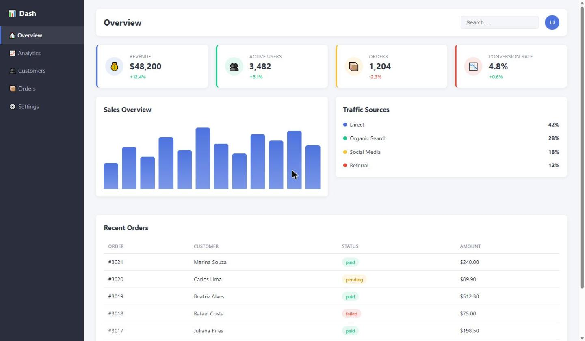

# Responsive Dashboard Template

A free, modern admin dashboard in plain HTML, CSS and JavaScript. Metronic-inspired look with a dark sidebar, six ready-made pages, a profile menu, light and dark themes, and zero dependencies or build step.



**[Live demo](https://lenivalestevao.github.io/responsive-dashboard-template/)**

## Pages

| Page | What it includes |
|---|---|
| **Overview** | Stat cards, revenue line chart, sales by category donut, recent orders, activity timeline |
| **Analytics** | KPIs, weekly visits bar chart, devices donut, traffic sources, top pages |
| **Orders** | Search, status filter, pagination, click a row to open the order details |
| **Customers** | Search, pagination, "Add customer" form |
| **Products** | Category filters, stock levels, "Add product" form |
| **Settings** | Profile, Security, Notifications and Appearance (light or dark) tabs |

Click your initials (LJ) in the top bar to open the account menu. The bell shows notifications, and the moon switches between light and dark mode.

## Features

- Collapsible sidebar on desktop, slide-in drawer on mobile
- Light and dark theme, remembered between visits
- Charts drawn with inline SVG, so there is no chart library to load
- Tables with search, filters and pagination
- Modals, toasts and dropdowns, all in vanilla JavaScript
- Hash routing (`#/orders`), so it works on GitHub Pages and any static host
- Responsive from phones to wide monitors

## Getting Started

1. Clone this repo or download the ZIP
2. Open `index.html` in your browser, or serve the folder with any static server

```bash
npx serve .
```

## Project Structure

```
index.html   page shell: sidebar, header, account menu, modal
style.css    design tokens (colors, spacing), layout and components
script.js    demo data, pages, charts, router and interactions
```

## Customize

- **Colors and theme:** edit the CSS variables at the top of `style.css` (`--primary`, `--aside` and the `[data-theme="dark"]` block)
- **Menu:** change the `NAV` list in `script.js`
- **New page:** add a function to the `pages` object in `script.js`, then add it to `NAV` and `META`
- **Real data:** the demo data lives at the top of `script.js` (`customers`, `products`, `orders`). Replace it with a call to your API

## License

MIT. Free to use for personal or commercial projects. A link back is appreciated but not required.

Made by [Leni Junior](https://github.com/lenivalestevao). Check out my other free templates on my profile.
